<a href="https://jerayfa.com/">
  <picture>
    <source media="(prefers-color-scheme: dark)" srcset="assets/banner-dark.svg" />
    <source media="(prefers-color-scheme: light)" srcset="assets/banner-light.svg" />
    
  </picture>
</a>

<p align="center">
  <a href="https://jerayfa.com/"></a>
  <a href="https://www.linkedin.com/in/jeray-fernandez/"></a>
  <a href="mailto:contact@jerayfa.com"></a>
</p>

<br />

## `(01)` Sobre mí

Estudio **Sistemas Microinformáticos y Redes** en Málaga: sistemas, redes y servidores. Mi siguiente paso es el **desarrollo web**.

Soy una persona tranquila, con facilidad para relacionarme y aprender rápido cualquier tarea nueva. La puntualidad y la responsabilidad son innegociables para mí, y afronto cada reto con constancia hasta conseguirlo.

```yaml
ubicacion:  Málaga, España
estudiando: SMR · DIGITECH (2026–27)
meta:       DAW · Desarrollo de Aplicaciones Web
intereses:  [tecnología, informática, videojuegos]
```

## `(02)` Trayectoria

| | Etapa | Detalle |
|:--|:--|:--|
| ✔ **Completado** | Educación Secundaria (ESO) | 2026 |
| 🔴 **En curso** | **SMR** · Sistemas Microinformáticos y Redes | DIGITECH · Redes, sistemas operativos, Microsoft 365, servicios en red y seguridad. Desde septiembre de 2026. |
| ◌ **Próxima meta** | **DAW** · Desarrollo de Aplicaciones Web | Evolucionar la base técnica de sistemas hacia la ingeniería de software y la creación de soluciones web completas. |

## `(03)` Certificados

| Curso | Emisor | Fecha | |
|:--|:--|:--|:--|
| **Aprende SQL** <br /><sub>29 lecciones, 112 ejercicios y 7 exámenes: consultas, filtros, joins y diseño de bases de datos.</sub> | Midudev | Oct 2026 | [Verificar ↗](https://certificados.midudev.com/1cd76327-3584-4388-ae26-e4fa99a77b3a.pdf) |
| **Introducción a Cisco Packet Tracer** <br /><sub>Creación y simulación de redes, dispositivos de red y cómo se conectan entre sí.</sub> | Cisco Networking Academy | Oct 2026 | [Verificar ↗](https://www.netacad.com/recognitions/verify/8f7eb28b-dc71-4041-bc88-d6b223c1c3d7) |

## `(04)` Habilidades

<table>
  <tr>
    <th align="left">Sistemas</th>
    <th align="left">Redes</th>
    <th align="left">Web y hardware</th>
  </tr>
  <tr valign="top">
    <td>
       <sub>aprendiendo</sub><br />
       <sub>aprendiendo</sub><br />
       <sub>aprendiendo</sub><br />
       <sub>aprendiendo</sub>
    </td>
    <td>
       <sub>aprendiendo</sub><br />
       <sub>aprendiendo</sub><br />
       <sub>aprendiendo</sub><br />
       <sub>aprendiendo</sub>
    </td>
    <td>
       <sub>básico ●○○</sub><br />
       <sub>básico ●○○</sub><br />
       <sub>básico ●○○</sub><br />
       <sub>medio ●●○</sub>
    </td>
  </tr>
</table>

## `(05)` Proyectos

> [!NOTE]
> **En el taller.** Estoy preparando los primeros proyectos para el portafolio. Puedes seguirlos en [jerayfa.com](https://jerayfa.com/).

**[Tidy ↗](https://github.com/Jeray665/Tidy)** · `C#` <br />
Optimizador seguro para Windows 11, en español: limpieza, optimizaciones, drivers, apps, red, seguridad y modo juego. Todo con copia de seguridad.

## `(06)` Actividad

<picture>
  <source media="(prefers-color-scheme: dark)" srcset="https://raw.githubusercontent.com/Jeray665/Jeray665/output/github-snake-dark.svg" />
  <source media="(prefers-color-scheme: light)" srcset="https://raw.githubusercontent.com/Jeray665/Jeray665/output/github-snake.svg" />
  
</picture>

## `(07)` ¿Hablamos?

Escríbeme a **[contact@jerayfa.com](mailto:contact@jerayfa.com)** o por [LinkedIn](https://www.linkedin.com/in/jeray-fernandez/).

<br />

<a href="https://jerayfa.com/">
  <picture>
    <source media="(prefers-color-scheme: dark)" srcset="assets/footer-dark.svg" />
    <source media="(prefers-color-scheme: light)" srcset="assets/footer-light.svg" />
    
  </picture>
</a>
